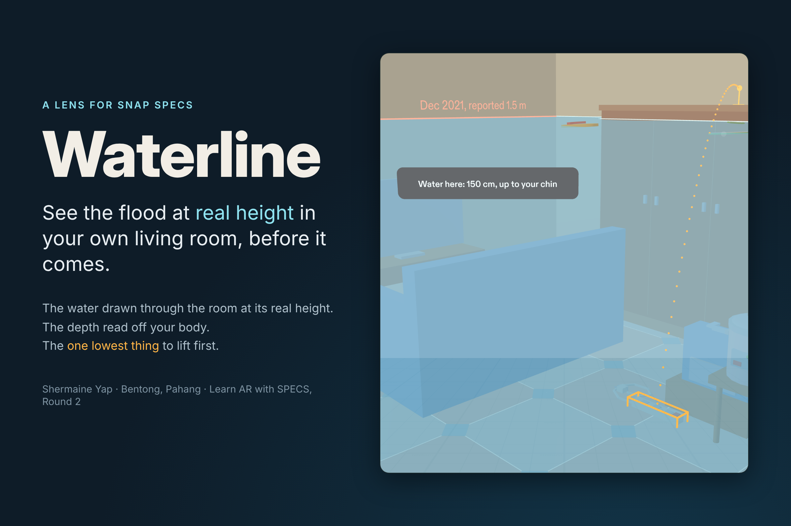
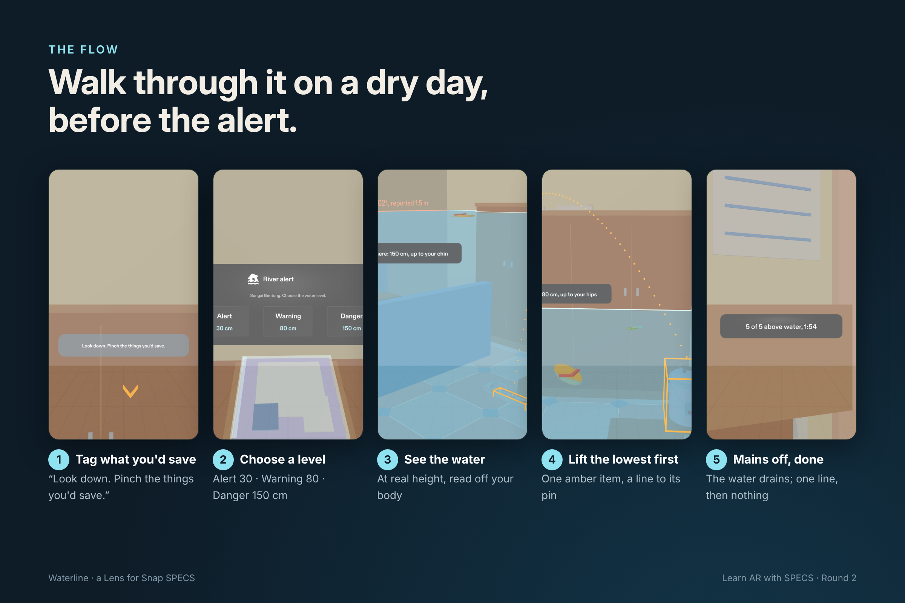
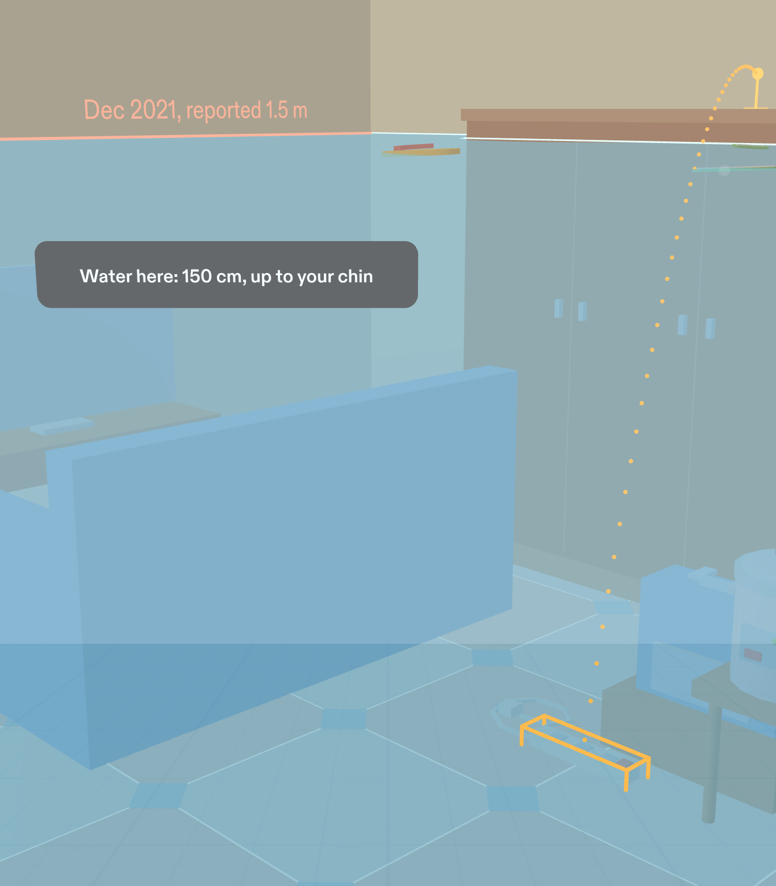
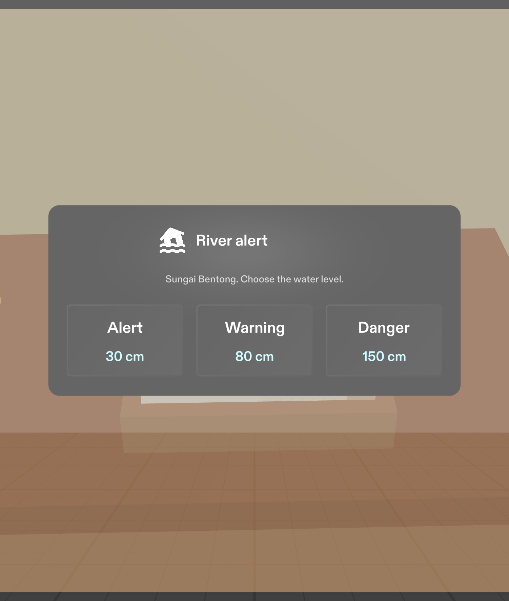
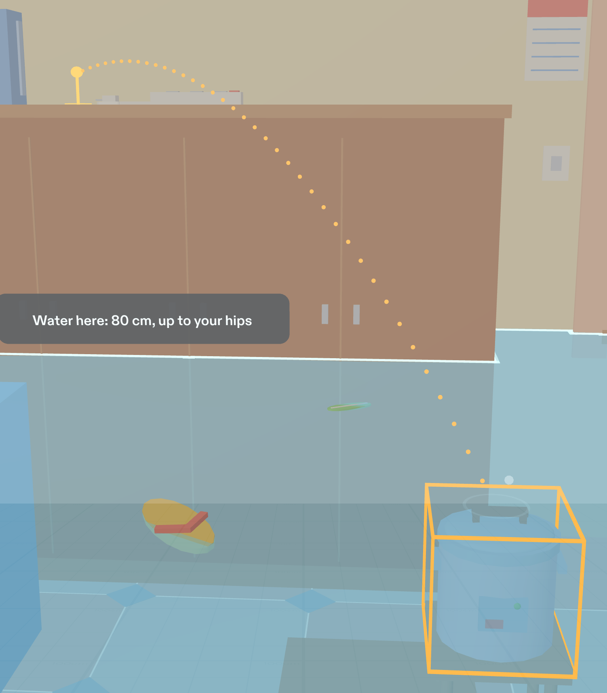
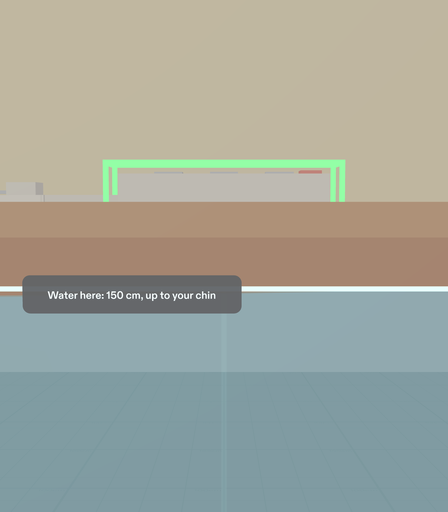
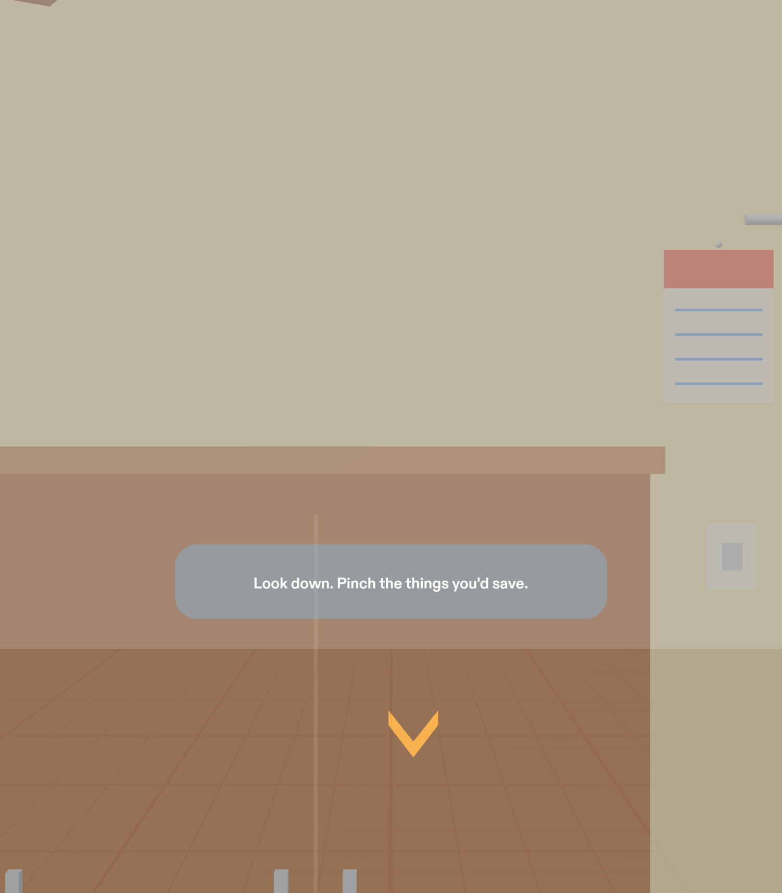
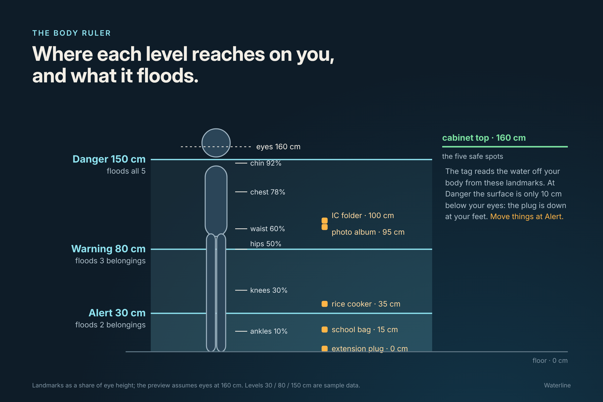

# Waterline: see the flood at real height in your own living room

**For families in flood-prone towns: before the river rises, Waterline draws the water through your own living room at its real height, tells you where it reaches on your body, and shows you the one lowest thing to lift first.**

A Lens for Snap SPECS, built for Devpost's **Learn AR with SPECS**, Round 2 (Nov 10 – Dec 7, 2026). Planned with the Devpost Learn `plan-lens` skill, built by Snap's CLAD agents in Lens Studio 5.23.2 through the Lens Studio MCP, and tested with LEAF. It runs in Lens Studio's preview; no glasses are needed.

**Demo video:** _link added after recording_

## For judges

| Criterion | Where to look |
|---|---|
| **Design** (a complete, coherent product) | [The flow](#the-flow), [Design decisions](#design-decisions), [How the design changed](#how-the-design-changed-five-rounds-of-design-notes) |
| **Technical implementation** (CLAD, Lens Studio, MCP) | [How it was built](#how-it-was-built), [LEAF results](#done-criteria-and-leaf-results), [`devpost/leaf-results.md`](devpost/leaf-results.md), [`devpost/leaf-log.txt`](devpost/leaf-log.txt) |
| **Innovation / idea** | [Why it belongs on glasses](#why-it-belongs-on-glasses), [The real problem](#the-real-problem-bentong-pahang) |
| **Presentation** | The video, the [gallery](#gallery), [What is simulated](#what-is-simulated) |

**What it uses on SPECS:** the head pose every frame (the ring under your head, the body word, the underwater state), Spectacles Interaction Kit interactables (pinch to tag, grab, carry and release with a snap), content at real height in centimetres, one-shot sounds placed at the item or switch they point to, and UI Kit panels shown one at a time. In the preview every pinch and grab comes from the mouse or LEAF's simulated hand, and no sound was checked by ear ([What is simulated](#what-is-simulated)).

## The real problem: Bentong, Pahang

I'm from Bentong. In December 2021 the floods came at night.

- In **Kampung Kemansur**, one resident told reporters the water rose to **about 1.5 m inside her house**, even though she had raised her floor about 0.9 m years earlier ([Malaysiakini, 24 Dec 2021](https://malaysiakini.com/news/604316)). That 150 cm is the Danger height in the Lens. It is one resident's account, not a surveyed mark.
- **1,518 people (372 families) in Bentong** were in 17 relief centres on 29 Dec 2021, and Pahang recorded 20 flood deaths ([Pahang state government, 29 Dec 2021](https://pahang.gov.my/pahang/resources/PDF/Berita/2021/Dis/(29hb)JUMLAH_MANGSA_BANJIR_DI_PAHANG_MENURUN_KEPADA_7,730_MANGSA.pdf)).
- Nationally, **55 people died** from December 2021 to January 2022 ([The Star, 8 Mar 2022](https://www.thestar.com.my/news/nation/2022/03/08/floods-55-fatalities-from-december-2021-to-january-2022)), and losses were **RM6.1 billion**, 0.40% of GDP ([DOSM special report, 28 Jan 2022](https://www.dosm.gov.my/portal-main/release-content/special-report-on-impact-of-floods-in-malaysia-2021)).
- It keeps happening. On 20 Sep 2026, 105 people were evacuated in Janda Baik ([NST](https://www.nst.com.my/amp/news/nation/2026/09/1537497/sungai-cheringin-overflow-triggers-flash-floods-105-evacuated)); on 18 Nov 2026, rescuers waded chest-deep near Kemasul ([Bernama](https://bernama.com/bm/news.php?id=2636610)).

A river reading like "89.00 m" means nothing in your own room. Nobody can picture where 1.5 m reaches until they see it against their own sofa and their own body, and by the night of the flood it is too late to plan what to lift first.

## The flow

Waterline is something you walk through **on a dry day, before the alert**, to see the water and plan the order. On real glasses it would stay quiet in the background until then.

1. **Tag what you'd save.** "Look down. Pinch the things you'd save." You pinch each belonging once; a small tick appears and fades.
2. **Choose a level.** A card with three big buttons, named after the levels on the Sungai Bentong river gauge: **Alert 30 cm, Warning 80 cm, Danger 150 cm**. Each level floods a different list: 2, 3 or 5 belongings.
3. **See the water.** A pale glowing surface rises through the room in about 4 seconds, with rain and a low rush. A ring sits on the water under your head and follows you. The tag reads the depth off your body: "Water here: 150 cm, up to your chin". At Danger a line on the wall marks the reported 2021 depth. Crouch, and the moment your eyes go under, the view turns cool and muffled.
4. **Lift the lowest thing first.** Exactly one item glows amber, with a dotted line up to its own glowing pin on the cabinet. Grab it, carry it, release it near the pin: it snaps, turns green with a soft tick, and the next lowest item lights up. If the next one is out of view, an edge arrow and a splash from its direction point you there.
5. **Mains off, and done.** When everything is safe, the wall switch glows. One pinch: a click, the water drains, the rain fades into morning birds, and one line stays for 4 seconds ("5 of 5 above water" and the time taken). Then everything disappears and the level card comes back, so you can try another level.

### Why it belongs on glasses

- **Draws in the world at real size:** the water is drawn at its true height against your body and your furniture. A phone can only give you a number.
- **Answers your body:** the ring, the body word and the underwater state are worked out from your head every frame.
- **Shares your view:** one cue at a time, where you are already looking, with an arrow and a sound when the next item is behind you.

## Gallery

| | |
|---|---|
|  |  |
| _At Danger: the reported 2021 line, the depth on your body, and the one item to lift._ | _Three levels, three different lists._ |
|  |  |
| _At Warning: 80 cm is "up to your hips"._ | _Released near its pin, the item snaps and turns green._ |
|  |  |
| _Crouch, and your eyes go under._ | _The start: one line, nothing else._ |

More: [`devpost/screenshots/`](devpost/screenshots/) and the composed cards in [`devpost/gallery/`](devpost/gallery/).

## Design decisions

- **One thing at a time.** Only the lowest item still under the water asks for attention; everything else stays quiet.
- **Numbers on the body, not on a panel.** "Up to your chin" or "up to your hips", from body landmarks as fractions of eye height: ankles 10%, knees 30%, hips 50%, waist 60%, chest 78%, chin 92%. The preview assumes eyes 160 cm above the floor; crouching then changes the word live.
- **Different levels, different lists.** The photo album and the IC folder sit on a sideboard at 95–100 cm, so Alert floods 2 belongings, Warning 3 and Danger 5. At Danger the plug is already below your knees in water you can't see through. The lesson is to move things at Alert.
- **Show nothing until needed.** At the start only the hint line shows. Panels appear when needed and fade after.
- **Additive display.** Black renders as transparent on SPECS, so nothing the user must see is dark. Text sits on a dark plate behind light letters, which reads well in the preview; on real glasses the plate may all but disappear (listed under feel unproven). The edge arrow and the depth tag draw on top of furniture so they can't be hidden.

The approved brief is [`devpost/design-brief.md`](devpost/design-brief.md). The changes made after approval are listed at its end.

## Done criteria and LEAF results

The brief has five done criteria. Each has a LEAF scenario in `Assets/Tests/` (criterion 5 has two), and **all six scenarios pass** in Lens Studio's preview. Full numbers are in [`devpost/leaf-results.md`](devpost/leaf-results.md), and the raw output of every run is in [`devpost/leaf-log.txt`](devpost/leaf-log.txt).

| # | Done criterion | LEAF test | Measured (27 Nov 2026) |
|---|---|---|---|
| 1 | Each level raises the water to its height within 5 s and flags only the items below it | `c1-levels` | Danger 150.00 cm in 3.70 s, 5 flagged; Warning 80.00 cm in 3.59 s, 3 flagged, "up to your hips"; Alert 30.00 cm in 3.35 s, 2 flagged |
| 2 | The ring stays under the head; crouching under the surface turns on the underwater state within 0.3 s; the body word changes | `c2-body` | ring within 5 cm over a 200 cm walk; underwater on in 0.089 s, off in 0.104 s; "up to your chin" becomes "over your head" |
| 3 | One item asks for attention, always the lowest; the arrow shows only when it's out of view | `c3-one-thing` | at each of 5 steps: 1 amber item, 1 pin, 1 line; arrow on when facing away, off once the item is in view |
| 4 | Released within 10 cm of its pin, an item snaps and turns green; anywhere else it stays amber | `c4-snap` | 6.0 cm away: snapped and turned green; 166.3 cm away: stayed amber; depth tag hidden in all 64 frames of the carry |
| 5a | After the switch, the water drains within 4 s, the summary shows and hides, and only the level card remains at 9 s | `c5-ending` | drained in 3.23 s; summary on for 4.00 s; only the level card at 9.00 s |
| 5b | Before a level is pressed, nothing else is visible | `c5b-quiet-before-level` | all 357 frames of the first 8 s: only the hint line and its chevron; card shown 1.05 s after the fifth tick fades |

A seventh scenario, `playthrough`, plays the whole Lens as a first-time user at Danger and at Alert. It acts only on what is in view or what a cue points to, and **every step at both levels had a cue**. LEAF's simulated hand carries slowly, so the run took 137.3 s at Danger and 70.9 s at Alert as played. With a person's carrying speed modelled instead (1 m/s, plus 1 s to grab and 1 s to place), it comes to about 65 s and 41 s.

## How the design changed: five rounds of design notes

I fixed the Lens with design notes, not code. CLAD made each change and re-ran the tests. The notes themselves are in [`devpost/design-notes.md`](devpost/design-notes.md).

1. **Round 1, the first build.** Everything worked, but the room was flat grey boxes, the water read as a grey tint, and the "preview stand-in" sign sat over the safe spots.
2. **Round 2, make it a home.** A furnished Malaysian terrace-house living room (teak cabinet, patterned tiles, sofa, ceiling fan, calendar, rain on the window), recognisable belongings, water with ripples, a glowing edge line and a floating slipper, and the edge arrow moved to the edge of view.
3. **Round 3, the first seconds.** Restarting the preview showed the summary, the depth tag and the level card all at once for a few seconds, and nothing told a first-time user what to do. Every panel now starts hidden, and one line says "Look down. Pinch the things you'd save."
4. **Round 4, a cue at every step.** A LEAF playthrough found four moments with no cue: the sideboard items after the third tag, the level card appearing behind you, the switch glowing out of view, and the depth tag clipped by the cabinet. Each now has a cue.
5. **Round 5, the cues that matter most.** A design audit found the amber outline turned pale olive under the water and the depth tag was the smallest, faintest text in the Lens. The amber now draws after the water. The tag sits on a plate, larger, 100 cm ahead, follows with a soft lag and hides while you carry. A hips landmark was added, the card waits until the last tick fades, and a line on the wall marks the reported 2021 depth.

Before that, reading the draft brief, I made two changes before approving it: I moved two belongings up to a sideboard so the three levels give different lists, and turned the depth tag's fixed phrase into a body word.

## What is simulated

- **The room and the belongings.** The living room, the five belongings, their heights and the cabinet are preview stand-ins, labelled in the scene. On real glasses you would tag your own things once; recognising them, remembering where they are between sessions, and knowing a real item was moved are out of scope. The snap stands in for that.
- **Your eye height.** The Lens assumes your eyes start 160 cm above the floor, which is the preview's camera. On real glasses the floor would have to be found first. Only crouching afterwards is measured live.
- **The levels.** The level card stands in for a real river alert. The names Alert, Warning and Danger follow the Sungai Bentong gauge at Kuala Marong (JPS station 0553351WL: Normal 86.00 m, Alert 88.00 m, Warning 88.30 m, Danger 89.00 m, a one-time snapshot from publicinfobanjir on 24 Nov 2026). This is a Bentong-district gauge, not the one on the Sungai Benus by Kampung Kemansur. **The in-room heights of 30, 80 and 150 cm are sample data**, not a conversion of those readings.
- **The 150 cm.** It comes from one resident's reported depth, not a surveyed flood mark.
- **The hands and the sounds.** Pinches, grabs and carries come from the preview's mouse or LEAF's simulated hand. The sounds play, but none was checked by ear.

**Feel unproven** (only real glasses and a real room can tell):
- **Lifting to eye height.** Every safe spot is on the cabinet top at 160 cm, eye height. That means lifting a rice cooker with raised arms and setting it down without seeing the top.
- **Bending.** Nobody bent down in any test; floor items were pinched from standing. At Danger the surface is only 10 cm below the eyes, so a real bend would trigger the underwater view mid-task.
- **Reading the cues.** Real hand tracking, how the depth tag, arrows and card read on the SPECS display, and whether the dark plate shows at all.
- **Comfort.** Comfort over a couple of minutes of turning and walking, and whether the tag's lag and the card's 1 s wait feel calm or slow.
- **The order.** Safety advice is to switch off the mains while everything is still dry ([TNB flood safety tips](https://www.tnb.com.my/floodsafetytips/)). The Lens puts the switch last, as the ending, which is a known limit of this version.

## How it was built

1. **Planned with `plan-lens`** (the Devpost Learn skill pack, in `.agents/skills/plan-lens`). It interviewed me, pushed back where the idea fought the glasses or the preview, and wrote `devpost/design-brief.md` with real heights and testable done criteria.
2. **Built by CLAD** (Snap's `ls-clad` plugin for Claude Code) in Lens Studio 5.23.2 through the Lens Studio MCP: the procedural room and belongings, the water surface, Spectacles Interaction Kit interactables, UI Kit panels, generated sounds (`Assets/GeneratedSFX`) and the LEAF scenarios.
3. **Tested with LEAF**, the same simulated hand for every criterion and for the full playthrough.
4. **Kept stable.** Lens Studio closed several times during long runs. An extra preview-hand package froze the editor with a hidden permission pop-up, so it was removed. After that, every test ran one at a time, with the project saved first and the raw log written as it went.

## Run it

1. Install [Lens Studio 5.23.2](https://ar.snap.com/download/v5-23-2).
2. Clone this repo and open `Paras.esproj` (the project's working name; Paras is Malay for "level").
3. In the Preview panel, choose **Interactive Preview** and the **Plane** environment. WASD moves, Q/E moves down/up, right-drag looks around, and a click is a pinch.
4. To run the tests, open the LEAF panel and run the scenarios in `Assets/Tests/`.

## Repo map

| Path | What it is |
|---|---|
| `devpost/design-brief.md` | The approved design brief from `plan-lens`, with the changes after approval at the end |
| `devpost/design-notes.md` | The design notes given to CLAD in each round |
| `devpost/leaf-results.md` | Every done criterion, its test and the measured numbers; playthrough timings; feel unproven |
| `devpost/leaf-log.txt` | Raw LEAF output of the final runs |
| `devpost/screenshots/`, `devpost/gallery/` | Preview captures and composed gallery cards |
| `Assets/Scripts/` | `WaterlineMain` (flow), `WaterlineState` (pure logic: levels, lowest first, body words), `WaterlineWater`, `WaterlineBody` (ring, depth tag, underwater), `WaterlineGuidance` (amber item, line, pin, edge arrow), `WaterlineBelonging`, `WaterlineSwitch`, the room and the UI panels |
| `Assets/Tests/` | LEAF scenarios and helpers |
| `Assets/GeneratedSFX/` | Rain, rush, splash, tick, click, birds, underwater |

## Licence

MIT for my own code and docs. Snap packages stay under Snap's licence.
