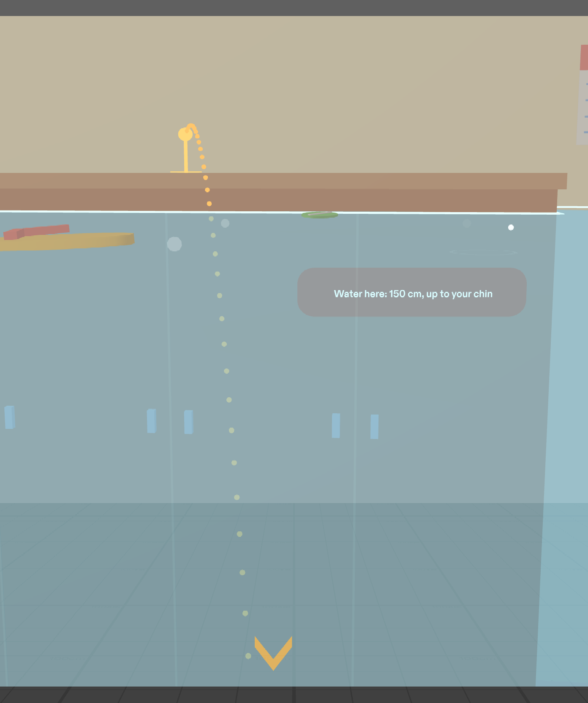
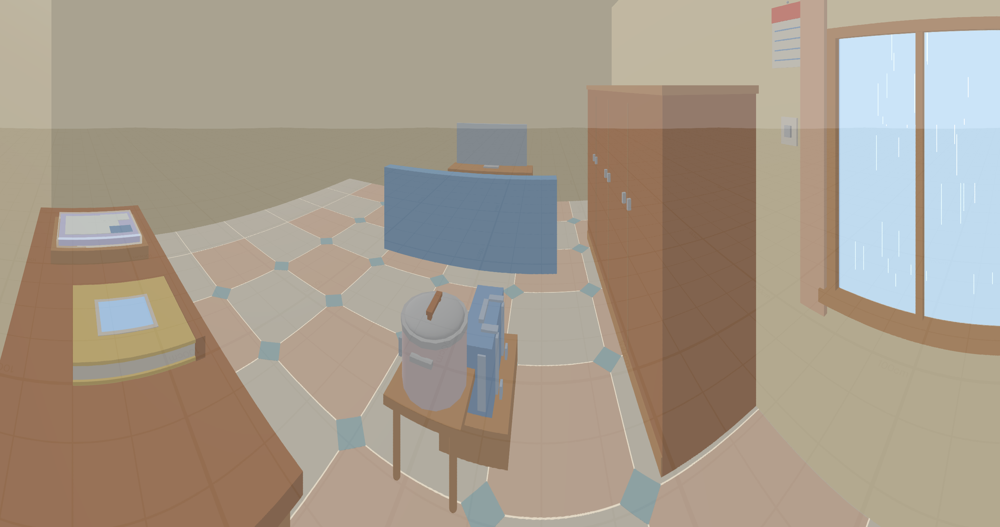
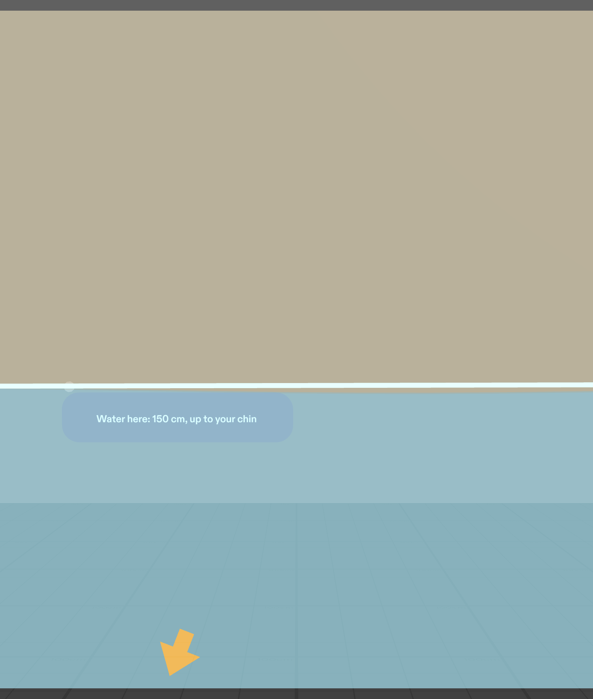
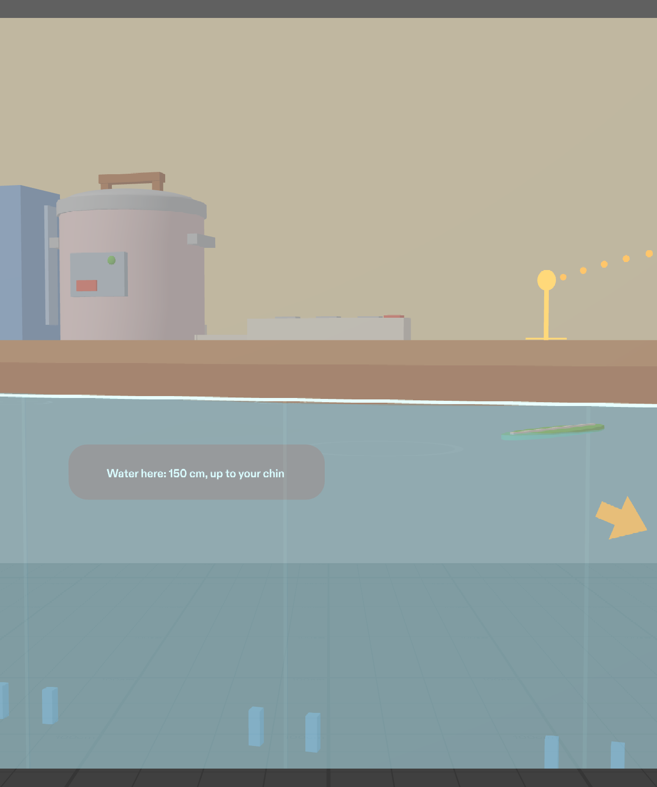
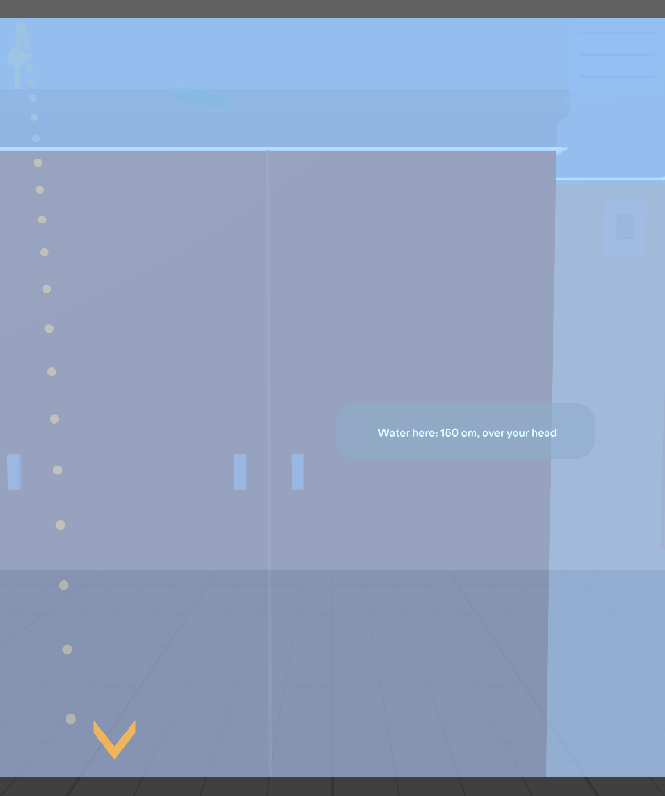
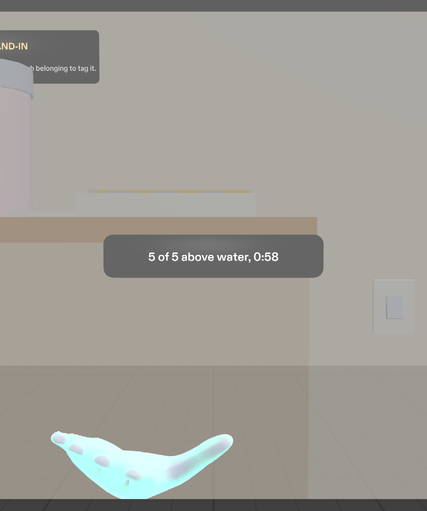
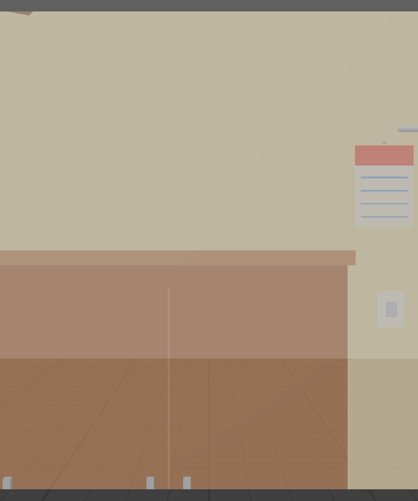

# Waterline

**For anyone who has to save a home before a flood: Waterline draws the coming water through your own living room at its real height, shows on your body how deep it will be, and lights up the one lowest thing to lift next.**

A Lens for Snap SPECS, built for Devpost's **Learn AR with SPECS**, Round 2 (Nov 10 – Dec 7, 2026). Planned with the Devpost Learn `plan-lens` skill, built by Snap's CLAD agents in Lens Studio 5.23.2 through the Lens Studio MCP, and tested with LEAF. It runs in Lens Studio's preview; no glasses are needed.

**Demo video:** _link added after recording_

## For judges

| Criterion | Where to look |
|---|---|
| **Design** (a complete, coherent product) | [The flow](#the-flow-one-spatial-moment), [Design decisions](#design-decisions), [How the design changed](#how-the-design-changed-four-rounds-of-design-notes) |
| **Technical implementation** (CLAD, Lens Studio, MCP) | [How it was built](#how-it-was-built), [LEAF results](#done-criteria-and-leaf-results) ([full results](devpost/leaf-results.md)) |
| **Innovation / idea** | [Why it belongs on glasses](#why-it-belongs-on-glasses), [The real problem](#the-real-problem-bentong-pahang) |
| **Presentation** | The video, the [screenshots](#screens), [What is simulated](#what-is-simulated) |

**SPECS capabilities used:** head pose every frame (the water ring, the depth on your body, the underwater state), hand tracking through the Spectacles Interaction Kit (pinch to tag, grab, carry and release), world-scale rendering at real heights in centimetres, spatial audio (rain and rushing water at the surface, a splash from the next item's direction), and UI Kit panels kept small and shown one at a time.

## The real problem: Bentong, Pahang

I'm from Bentong. In December 2021 the floods came at night.

- In **Kampung Kemansur**, a resident told reporters the water rose to **about 1.5 m inside her house**, even though she had raised her floor about 0.9 m years earlier ([Malaysiakini, 24 Dec 2021](https://malaysiakini.com/news/604316)). That 150 cm is the Danger height in the Lens. It is one resident's account, not a surveyed mark.
- **1,518 people (372 families) in Bentong** were in 17 relief centres on 29 Dec 2021; Pahang recorded 20 flood deaths ([Pahang state government, 29 Dec 2021](https://pahang.gov.my/pahang/resources/PDF/Berita/2021/Dis/(29hb)JUMLAH_MANGSA_BANJIR_DI_PAHANG_MENURUN_KEPADA_7,730_MANGSA.pdf)).
- Nationally, **55 people died** from December 2021 to January 2022 ([The Star, 8 Mar 2022](https://www.thestar.com.my/news/nation/2022/03/08/floods-55-fatalities-from-december-2021-to-january-2022)), and losses were **RM6.1 billion**, 0.40% of GDP ([DOSM special report, 28 Jan 2022](https://www.dosm.gov.my/portal-main/release-content/special-report-on-impact-of-floods-in-malaysia-2021)).
- It keeps happening. On 20 Sep 2026, 105 people were evacuated in Janda Baik ([NST](https://www.nst.com.my/amp/news/nation/2026/09/1537497/sungai-cheringin-overflow-triggers-flash-floods-105-evacuated)); on 18 Nov 2026, rescuers waded chest-deep near Kemasul ([Bernama](https://bernama.com/bm/news.php?id=2636610)).

When the river alert comes, one person usually moves everything, with minutes to spare and both hands full. A gauge reading like "89.00 m" means nothing in your own room, and nobody can picture where 1.5 m actually reaches.

## The flow: one spatial moment

1. **Tag, on a dry day.** "Look down. Pinch the things you'd save." You pinch each belonging once; a small tick appears and fades.
2. **The river alert.** One card with three big buttons, named after the real Sungai Bentong gauge: **Alert 30 cm, Warning 80 cm, Danger 150 cm**. Each level flags a different list: 2, 3 or 5 belongings.
3. **See the water.** A pale glowing surface rises through the room over about 4 seconds, with rain and a low rush at the surface. A ring sits on the water under your head and follows you. The depth tag reads it off your own body: "Water here: 150 cm, up to your chin". Crouch, and the moment your eyes go under, the view turns cool and muffled.
4. **Lift the lowest thing first.** Exactly one item glows amber, with a dotted line up to its own glowing pin on the cabinet. Grab it, carry it, release it near the pin: it snaps, turns green with a soft tick, and the next lowest item lights up. If the next one is out of view, an edge arrow and a splash from its direction point you there.
5. **Mains off, and done.** Once everything is safe, the wall switch glows. One pinch: a click, the water drains, the rain fades into morning birds, and one line stays for 4 seconds, "5 of 5 above water, 1:55". Then everything disappears and the level card comes back, so you can rehearse another level.

### Why it belongs on glasses

- **Draws in the world at real size:** the water is drawn at its true height against your body and your furniture. A phone can only give you a number.
- **Answers your body:** the ring, the depth word and the underwater state are recomputed from your head every frame.
- **Leaves your hands free:** the person moving things has both hands full, so the next step shows up where they are already looking, with no screen to hold.

## Screens

| | |
|---|---|
|  |  |
|  |  |
|  |  |
|  |  |

## Design decisions

- **One thing at a time.** Only the lowest item still under the water asks for attention. Everything else stays quiet.
- **Numbers on the body, not on a panel.** "Up to your chin" or "above your knees", worked out from your real eye height (ankles 10%, knees 30%, waist 60%, chest 78%, chin 92%).
- **Different levels, different lists.** Two belongings sit on a sideboard at 95–100 cm, so Alert flags 2, Warning 3 and Danger 5. That gives a reason to come back and rehearse another level.
- **Show nothing until needed.** Before the first tag, only the hint line shows; panels appear when needed and fade after.
- **Additive display:** light colours only, because black renders as transparent on SPECS. Cues that must never be hidden (the edge arrow and the depth tag) draw on top of furniture.

The approved brief is [`devpost/design-brief.md`](devpost/design-brief.md).

## Done criteria and LEAF results

Every done criterion in the brief has a LEAF scenario in `Assets/Tests/`. **All six pass** in Lens Studio's preview (full numbers in [`devpost/leaf-results.md`](devpost/leaf-results.md)).

| # | Done criterion | LEAF test | Measured |
|---|---|---|---|
| 1 | Each level raises the water to its height within 5 s and flags only the items below it | `c1-levels` | Danger 150.00 cm in 3.72 s, 5 flagged; Warning 80.00 cm in 3.55 s, 3 flagged; Alert 30.00 cm in 3.37 s, 2 flagged |
| 2 | The ring follows the head; crouching under the surface turns on the underwater state within 0.3 s; the body word changes | `c2-body` | ring offset 0.00 cm over a 200 cm walk; underwater on in 0.091 s, off in 0.090 s; "up to your chin" → "over your head" |
| 3 | Exactly one item asks for attention, always the lowest; the arrow shows only when it's out of view | `c3-one-thing` | 1 amber item, 1 pin, 1 line at each of 5 steps; arrow on facing away, off once the album is in view |
| 4 | Released within 10 cm of its pin, an item snaps and turns green; anywhere else it stays amber | `c4-snap` | 6.0 cm away: snapped to 0.00 cm, green, next item lit 0.24 s later; 166.3 cm away: stayed amber |
| 5a | After the switch, the water drains within 4 s, the summary shows and hides, and only the level card remains at 9 s | `c5-ending` | drained in 3.06 s; summary shown for 4.02 s; only the level card at 9.01 s |
| 5b | Before any level is pressed, nothing else is visible | `c5b-quiet-before-level` | all 358 frames of the first 8 s checked: only the hint line and its chevron |

A seventh scenario, `playthrough`, plays the whole Lens as a first-time user at Danger and at Alert, acting only on what is in view or what a cue points to. **Every step at both levels had a cue.** At a modelled human pace it takes **61.7 s at Danger** and **38.7 s at Alert**.

## How the design changed: four rounds of design notes

I fixed the Lens with design notes, not code. CLAD made each change and re-ran the tests.

1. **Round 1, the first build.** Everything worked, but the room was flat grey boxes, the water read as a grey tint, and the "preview stand-in" sign sat on the cabinet over the safe spots.
2. **Round 2, make it a home.** A furnished Malaysian terrace-house living room (teak cabinet, patterned tiles, sofa, ceiling fan, calendar, rain on the window), recognisable belongings, water with ripples, a glowing edge line and a floating slipper, a smaller depth tag, and the edge arrow moved to the true edge of view.
3. **Round 3, the first seconds.** Restarting the preview showed the summary, the depth tag and the level card all at once for a few seconds, and nothing told a first-time user what to do. Every panel now starts hidden, and one line says "Look down. Pinch the things you'd save."
4. **Round 4, a cue at every step.** A LEAF playthrough found four places with no cue: the sideboard items after the third tag, the level card appearing behind you, the switch glowing out of view, and the depth tag clipped by the cabinet. Each now has a cue, and the playthrough checks it.

Earlier, in the brief itself, the interview moved two belongings up to a sideboard so the three levels give different lists, and turned the depth tag's fixed phrase into a body word computed from your eye height.

## What is simulated

- **The room and the belongings.** The living room, the five belongings, their heights and the cabinet are preview stand-ins, labelled in the scene. On real glasses you would tag your own things once, on a dry day; recognising them and remembering where they are between sessions is out of scope.
- **The alert.** The level card stands in for a real river alert. The names Alert, Warning and Danger follow the real gauge, Sg. Bentong at Kuala Marong (JPS station 0553351WL: Normal 86.00 m, Alert 88.00 m, Warning 88.30 m, Danger 89.00 m, a one-time snapshot from publicinfobanjir on 24 Nov 2026). **The in-room heights of 30, 80 and 150 cm are sample data**, not a conversion of those readings.
- **The hands and the lifting.** Pinches, grabs and carries come from the preview's simulated hand. Weight, balance and setting a rice cooker down on a 160 cm cabinet can't be felt here.
- **The 150 cm.** It comes from one resident's reported depth, not a surveyed flood mark.

Feel unproven (only real glasses can tell): real hand tracking, comfort over a couple of minutes, how the cues read on the SPECS display, and how the sounds land. Details are in [`devpost/leaf-results.md`](devpost/leaf-results.md#3-what-the-tests-cant-prove-feel-unproven).

## How it was built

1. **Planned with `plan-lens`** (the Devpost Learn skill pack, in `.agents/skills/plan-lens`). It interviewed me, pushed back where the idea fought the glasses or the preview, and wrote `devpost/design-brief.md` with real heights and testable done criteria.
2. **Built by CLAD** (Snap's `ls-clad` plugin for Claude Code) in Lens Studio 5.23.2 through the Lens Studio MCP: the procedural room and belongings, the water surface, Spectacles Interaction Kit interactables, UI Kit panels, generated sounds (`Assets/GeneratedSFX`) and the LEAF scenarios.
3. **Tested with LEAF**, the same simulated hand for every criterion and for the full playthrough.

## Run it

1. Install [Lens Studio 5.23.2](https://ar.snap.com/download/v5-23-2).
2. Clone this repo and open `Paras.esproj` (the project's working name).
3. In the Preview panel, choose **Interactive Preview** and the **Plane** environment. WASD moves, Q/E moves down/up, right-drag looks around, and a click is a pinch.
4. To run the tests, open the LEAF panel and run the scenarios in `Assets/Tests/`.

## Repo map

| Path | What it is |
|---|---|
| `devpost/design-brief.md` | The approved design brief from `plan-lens` |
| `devpost/leaf-results.md` | Every done criterion, its test and the measured numbers; playthrough timings |
| `devpost/screenshots/` | Preview captures |
| `Assets/Scripts/` | `WaterlineMain` (flow), `WaterlineWater`, `WaterlineBody` (ring, depth tag, underwater), `WaterlineGuidance` (amber item, line, pin, edge arrow), `WaterlineBelonging`, `WaterlineSwitch`, the room and UI panels |
| `Assets/Tests/` | LEAF scenarios and helpers |
| `Assets/GeneratedSFX/` | Rain, rush, splash, tick, click, birds, underwater |

## Licence

MIT for my own code and docs. Snap packages stay under Snap's licence.
